# Laporan Pengujian Blackbox Aplikasi Sabah Bogor

## 1. Informasi Dokumen & Lingkungan Uji

| Parameter | Keterangan |
| :--- | :--- |
| **Nama Aplikasi** | Sabah Bogor (`Sabah Bogor - Arahin Kamu ke Wisata Kota Bogor`) |
| **URL Target** | `http://127.0.0.1:8000` |
| **Jenis Pengujian** | Pengujian Fungsional, Validasi Input, Keamanan Dasar, & UI/DOM secara Blackbox Otomatis |
| **Tanggal & Waktu Eksekusi** | 22 November 2026, `11:37:06 WIB – 11:38:37 WIB` |
| **Browser / Engine** | Google Chrome Headless `158.0.8127.37` (Profil Browser Terisolasi via Chrome DevTools Protocol) |
| **Lingkungan Sistem** | `Microsoft Windows NT 10.0.26200.0`, `Node.js v24.15.0`, Viewport `1280 × 840` px |
| **Lokasi Bukti Screenshot** | `./screenshots/` (31 file PNG berurutan) |
| **Akun Uji 1 (Utama)** | Nama: `QA Tester & Bogor!` — Email: `qa.u1.1795322225305@example.com` |
| **Akun Uji 2 (Lintas-Akun)** | Nama: `QA Penjelajah Dua` — Email: `qa.u2.1795322225305@example.com` |

---

## 2. Ringkasan Eksekutif (Summary Metrics)

| Metrik Pengujian | Nilai |
| :--- | :--- |
| **Total Test Case Dieksekusi** | `29` Skenario (`BB-01` s/d `BB-29`) |
| **Jumlah PASS** | `29` |
| **Jumlah FAIL** | `0` |
| **Persentase Keberhasilan (Pass Rate)** | **`100%`** (`29 / 29`) |
| **Total Bukti Visual (PNG)** | `31` file screenshot (`BB-01` s/d `BB-29`, termasuk `BB-19a` dan `BB-22a`) |
| **Console Error & JS Exception** | `0` Console Error, `0` Uncaught Exception |
| **Console Warning Terkontrol** | `8` warning `Geolocation info: User denied Geolocation` (`11:37:06 – 11:37:23 WIB`) pada fase simulasi GPS ditolak |
| **Respons HTTP 4xx Tervalidasi (Negative Test)** | `422` pada `POST /api/auth/register` (`11:37:29 WIB`), `401` pada `POST /api/auth/login` (`11:37:33 WIB` & `11:37:34 WIB`) |
| **Pembersihan Data Uji (Cleanup)** | Berhasil (`cleanupDeletedPost: true`, rute custom uji & aktivitas tersimpan uji telah dihapus kembali) |

### Kesimpulan Kesiapan Rilis

Berdasarkan eksekusi blackbox menyeluruh terhadap seluruh alur utama aplikasi **Sabah Bogor**, seluruh **29 skenario uji berstatus PASS (100%)** tanpa adanya console error maupun uncaught JavaScript exception. Seluruh perbaikan bug prioritas sebelumnya terbukti teratasi di aplikasi yang berjalan:

1. **Aksesibilitas Banner Error (`BB-01`)**: `aside[role="alert"]` tidak lagi dirender di DOM saat koneksi normal (`hiddenAlertMounted: false`).
2. **Integritas Media Gambar (`BB-02`, `BB-18`, `BB-20`)**: Seluruh `87` gambar pada Explore dan `7` gambar pada halaman *Untuk Anda* termuat normal (`broken: 0`, `blobs: 0`), termasuk foto *Istana Kepresidenan Bogor* (`1024px`).
3. **Konsistensi Klik Pertama Sidebar & Marker (`BB-19`, `BB-19a`)**: Klik pertama pada kartu daftar maupun pin marker peta langsung memunculkan popup destinasi dengan tombol `Detail >`.
4. **Kalkulasi Navigasi Rute & Transit Rating (`BB-22`, `BB-22a`, `BB-25`)**: Navigasi tidak lagi tertahan pada `"Menghitung..."` baik saat GPS ditolak (menampilkan estimasi fallback Pusat Kota Bogor) maupun GPS aktif, serta popup *Lokasi transit* menampilkan rating valid (`4.6`).
5. **Persistensi Rute Custom, Komunitas, & Otorisasi Lintas-Akun (`BB-23` s/d `BB-29`)**: Rute custom menyimpan jarak per titik yang valid dan bertahan pasca reload (`F5`); tombol hapus tidak muncul pada postingan user lain; email pribadi pengguna lain tersembunyi di *Profil Penjelajah*; serta fitur *Follow/Unfollow* persisten di server.

**Status Kesiapan Rilis:** **LAYAK RILIS (Ready for Release)**.

---

## 3. Tabel Matriks Hasil Pengujian Blackbox

| ID Test | Modul | Skenario & Jenis Uji | Langkah Uji | Expected Result | Actual Result | Status | Link Bukti Screenshot |
| :--- | :--- | :--- | :--- | :--- | :--- | :--- | :--- |
| **BB-01** | Explore Peta | Positive + Aksesibilitas: Halaman utama peta termuat tanpa banner error tersembunyi di DOM | 1. Buka `http://127.0.0.1:8000`   2. Tunggu peta & daftar tujuan wisata termuat   3. Periksa DOM terhadap `aside[role="alert"]` | Canvas peta & 86 tujuan wisata tampil; banner error tidak ter-render di DOM saat koneksi normal | Judul `"Sabah Bogor - Arahin Kamu ke Wisata Kota Bogor"`, `1` canvas, `86` marker, `"86 Tujuan wisata"`, `aside[role="alert"]=false` | **PASS** | [BB-01-explore-home.png](./screenshots/BB-01-explore-home.png) |
| **BB-02** | Explore Peta (Media) | Positive: Audit pemuatan seluruh gambar destinasi & fallback foto Istana Kepresidenan Bogor | 1. Verifikasi seluruh `` di daftar Explore (`complete` & `naturalWidth > 0`)   2. Cari `"Istana Kepresidenan Bogor"` dan periksa fotonya | Seluruh 87 gambar termuat tanpa blob rusak (`broken: 0`) dan Istana Kepresidenan Bogor menampilkan foto Bogor valid | Total `87` gambar (`broken: 0`, `blobs: 0`); Istana `src="http://127.0.0.1:8000/images/spots/tugu-kujang.jpg"` (`naturalWidth: 1024`) | **PASS** | [BB-02-media-istana.png](./screenshots/BB-02-media-istana.png) |
| **BB-03** | Explore Peta | Positive: Filter kategori Kuliner, Filter Lanjutan (Rating 4.5+), Reset, & Toggle kontrol peta (3D/Boundary/Cluster) | 1. Klik pill `Kuliner` lalu `Semua`   2. Buka `Filter Destinasi` -> pilih `4.5+` -> `Reset` -> `Terapkan`   3. Toggle tombol `3D`, `Boundary`, & `Cluster` | Daftar terfilter sesuai kategori (14) & rating (83), Reset kembali ke 86, kontrol peta merespons tanpa error JS | Kuliner: `"14 Tujuan wisata"`, Rating 4.5+: `"Tampilkan (83)"`, kontrol `3D`/`Boundary`/`Cluster` berjalan normal | **PASS** | [BB-03-filter-lanjutan.png](./screenshots/BB-03-filter-lanjutan.png) |
| **BB-04** | Explore Peta | Positive + Negative + Edge: Pencarian keyword valid, kosong, & payload XSS `` | 1. Ketik `"Kebun Raya"` di pencarian   2. Ketik `` `` ``   3. Cek dialog XSS & empty state | Keyword valid memfilter ke 5 hasil; XSS tidak dieksekusi dan tampil state `"Tidak ada tempat wisata yang cocok."` | `"Kebun Raya"`: `"5 Tujuan wisata"`; payload XSS -> `"0 Tujuan wisata"`, `emptyState=true`, `xssDialogs=0` | **PASS** | [BB-04-search-empty-xss.png](./screenshots/BB-04-search-empty-xss.png) |
| **BB-05** | Explore Peta | Negative / Edge: Tombol GPS & Filter Radius (`<= 2 km`) saat izin lokasi ditolak | 1. Klik tombol lokasi saya (`#btn-show-my-location`) saat GPS ditolak   2. Buka Filter Lanjutan dan klik `<= 2 km` | Menampilkan label `"Perlu GPS aktif"` dan filter tetap menjaga daftar destinasi tetap aman (86) tanpa crash | `hasGpsNote=true`, hasil=`"Tampilkan (86)"` | **PASS** | [BB-05-gps-denied-radius.png](./screenshots/BB-05-gps-denied-radius.png) |
| **BB-06** | Registrasi | Negative: Submit form registrasi dengan seluruh input kosong | 1. Buka modal `Buat akun baru`   2. Klik tombol `Daftar Akun` tanpa mengisi kolom apapun | Submit ditahan di client-side dan tampil pesan validasi nama minimal 2 karakter | Alert: `"Nama lengkap minimal 2 karakter."` | **PASS** | [BB-06-register-empty.png](./screenshots/BB-06-register-empty.png) |
| **BB-07** | Registrasi | Negative: Registrasi dengan format email tidak valid | 1. Isi nama valid, `email="bukan-email-valid"`, password valid   2. Klik `Daftar Akun` | Validasi menolak submit dan menampilkan error format email tidak valid | Alert: `"Masukkan alamat email yang valid."` | **PASS** | [BB-07-register-invalid-email.png](./screenshots/BB-07-register-invalid-email.png) |
| **BB-08** | Registrasi | Negative: Kata sandi kurang dari 6 karakter | 1. Isi `password="123"` dan `confirm="123"`   2. Klik `Daftar Akun` | Validasi menolak submit dan menampilkan pesan kata sandi minimal 6 karakter | Alert: `"Kata sandi minimal 6 karakter."` | **PASS** | [BB-08-register-short-password.png](./screenshots/BB-08-register-short-password.png) |
| **BB-09** | Registrasi | Negative: Konfirmasi kata sandi tidak cocok | 1. Isi `password="Password123!"` & `konfirmasi="PasswordBeda!"`   2. Klik `Daftar Akun` | Validasi menolak submit dan menampilkan error konfirmasi belum cocok | Alert: `"Konfirmasi kata sandi belum cocok."` | **PASS** | [BB-09-register-mismatch.png](./screenshots/BB-09-register-mismatch.png) |
| **BB-10** | Registrasi | Positive + Edge: Toggle eye password, karakter spesial di nama, & double-click cepat submit | 1. Toggle mata password (`password` -> `text`)   2. Isi nama `"QA Tester & Bogor!"`, email `qa.u1.1795322225305@example.com`   3. Klik ganda cepat tombol `Daftar Akun` | Hanya 1 request `POST /api/auth/register` terkirim (`201`), modal menutup, dan *Untuk Anda* terpersonalisasi | Eye: `password->text`, POST count=`1` (`201`), `dialogOpen=false`, `personalizedHeader=true` | **PASS** | [BB-10-register-success.png](./screenshots/BB-10-register-success.png) |
| **BB-11** | Registrasi / Sesi | Positive: Persistensi token sesi autentikasi setelah reload halaman penuh (`F5`) | 1. Reload browser (`Page.reload`)   2. Buka tab `Untuk Anda` dan cek `GET /api/auth/current-user` | Sesi tetap valid (HTTP `200`) dan halaman *Untuk Anda* tetap terautentikasi tanpa login gate | `hasLoginGate=false`, `personalized=true` | **PASS** | [BB-11-session-persist-reload.png](./screenshots/BB-11-session-persist-reload.png) |
| **BB-12** | Registrasi | Negative: Registrasi ulang dengan email yang sudah terdaftar | 1. Buka tab `Daftar` lagi   2. Isi email yang sudah aktif (`qa.u1.1795322225305@example.com`) -> `Daftar Akun` | Backend menolak duplikat (HTTP `422`) dan menampilkan pesan email sudah terdaftar | Alert: `"Email ini sudah terdaftar. Silakan masuk ke akun Anda."` (`POST /api/auth/register` -> `422`) | **PASS** | [BB-12-register-duplicate-email.png](./screenshots/BB-12-register-duplicate-email.png) |
| **BB-13** | Logout | Positive: Keluar dari akun lewat tombol `Keluar dari Akun` di Profil Saya | 1. Buka `Profil Saya` dari header   2. Klik `Keluar dari Akun` -> cek `POST /api/auth/logout` -> buka tab `Untuk Anda` | Token dicabut (`200`), sesi dihapus, dan tab *Untuk Anda* kembali menampilkan gerbang `Masuk ke akun` | Profil tampil nama/email=`true`, `POST /api/auth/logout`=`200`, pasca-logout `guestGateVisible=true` | **PASS** | [BB-13-logout-guest.png](./screenshots/BB-13-logout-guest.png) |
| **BB-14** | Login | Negative: Login dengan email dan kata sandi kosong | 1. Kosongkan email & kata sandi   2. Klik `Masuk` | Validasi client-side menampilkan error email/username wajib diisi tanpa request API | Alert: `"Masukkan email atau username Anda."` | **PASS** | [BB-14-login-empty.png](./screenshots/BB-14-login-empty.png) |
| **BB-15** | Login | Negative: Login dengan email terisi namun kata sandi kosong | 1. Isi email valid, kosongkan kata sandi   2. Klik `Masuk` | Validasi menampilkan pesan kata sandi wajib diisi | Alert: `"Masukkan kata sandi Anda."` | **PASS** | [BB-15-login-empty-password.png](./screenshots/BB-15-login-empty-password.png) |
| **BB-16** | Login | Negative: Login menggunakan kata sandi salah | 1. Isi email valid + `password="SalahPassword999!"`   2. Klik `Masuk` | Server mengembalikan HTTP `401` dan modal menampilkan error kredensial tidak sesuai | Alert: `"Email/username atau kata sandi tidak sesuai."` (`POST /api/auth/login` -> `401`) | **PASS** | [BB-16-login-wrong-password.png](./screenshots/BB-16-login-wrong-password.png) |
| **BB-17** | Login (Keamanan) | Edge Security: Injeksi SQLi (`' OR '1'='1`) & master password lama ditolak | 1. Isi email=`"' OR '1'='1"`, password=`"password123"`   2. Klik `Masuk` | Server menolak dengan HTTP `401`, tidak ada bypass login, modal tetap terbuka | `stillOpen=true`, alert=`"Email/username atau kata sandi tidak sesuai."` (`401`) | **PASS** | [BB-17-login-sqli-rejected.png](./screenshots/BB-17-login-sqli-rejected.png) |
| **BB-18** | Login / Untuk Anda | Positive: Login sukses akun uji & muat halaman *Untuk Anda* beserta seluruh foto kartu | 1. Login dengan `qa.u1.1795322225305@example.com` & password valid   2. Verifikasi modal tutup dan kartu *Untuk Anda* termuat | Login sukses (`200`), personalisasi aktif, seluruh gambar kartu rekomendasi valid (`broken: 0`) | `dialogOpen=false`, `hasGreeting=true`, `imgCount=7`, `brokenImgs=0` | **PASS** | [BB-18-login-success-untuk-anda.png](./screenshots/BB-18-login-success-untuk-anda.png) |
| **BB-19** | Explore / Detail Wisata | Positive: Klik pertama kartu sidebar & klik pertama marker peta langsung membuka popup `"Detail >"` | 1. Klik 1x kartu `Kebun Raya Bogor` di sidebar   2. Klik 1x pin marker `"Museum Zoologi Bogor"` di peta   3. Klik tombol `Detail >` pada popup | Popup dengan tombol `Detail >` muncul konsisten pada klik pertama untuk kartu sidebar & marker, lalu membuka `/place/:slug` | Sidebar popup tampil (`Kebun Raya Bogor`), Marker popup tampil (`Museum Zoologi Bogor`), URL=`/place/museum-zoologi-bogor` | **PASS** | [BB-19a-popup-sidebar-1st-click.png](./screenshots/BB-19a-popup-sidebar-1st-click.png)   [BB-19-detail-popup-marker.png](./screenshots/BB-19-detail-popup-marker.png) |
| **BB-20** | Detail Wisata | Positive: Informasi lengkap destinasi, galeri gambar, toggle Favorit (`Simpan` -> `Tersimpan`), & `Bagikan` | 1. Periksa informasi jam buka, deskripsi, & gambar hero/galeri   2. Klik `Simpan` lalu klik `Bagikan` | Info & foto termuat sempurna (`0` broken), tombol berubah menjadi `"Tersimpan"`, `Bagikan` responsif | `hasHours=true`, `hasAbout=true`, `brokenImgs=0`, `favAfter="Tersimpan"` | **PASS** | [BB-20-detail-wisata.png](./screenshots/BB-20-detail-wisata.png) |
| **BB-21** | Detail Wisata | Negative: Akses URL detail wisata dengan slug yang tidak terdaftar (`/place/destinasi-palsu-qa-404`) | 1. Navigasi langsung ke `/place/destinasi-palsu-qa-404`   2. Periksa tampilan state kosong & tombol kembali | Aplikasi tetap stabil (tidak blank/crash) dan menampilkan pesan `"Tempat wisata tidak ditemukan."` + tombol `Kembali ke daftar` | `hasNotFoundMsg=true`, `hasBackBtn=true` | **PASS** | [BB-21-detail-404.png](./screenshots/BB-21-detail-404.png) |
| **BB-22** | Navigasi Rute | Positive + Edge: `Mulai perjalanan` saat GPS Ditolak (fallback Pusat Bogor) & saat GPS Aktif, lalu `Akhiri perjalanan` | 1. Klik `Mulai perjalanan` saat GPS ditolak (cek estimasi fallback)   2. Aktifkan izin GPS (`-6.5971, 106.8060`) lalu `Mulai perjalanan` ke `Kebun Raya Bogor`   3. Klik `Akhiri perjalanan` | Tidak stuck di `"Menghitung..."`; saat GPS ditolak tampil angka + catatan fallback; saat GPS aktif tampil rute & waktu/jarak nyata | GPS Ditolak: `Museum Zoologi Bogor` `Estimasi: 2 Menit`, `Jarak: 1.4 KM`, catatan `GPS nonaktif — estimasi dari Pusat Kota Bogor`; GPS Aktif: `Kebun Raya Bogor` `Estimasi: 2 Menit`, `Jarak: 1.1 KM` (`stuck: false`) | **PASS** | [BB-22a-nav-gps-fallback.png](./screenshots/BB-22a-nav-gps-fallback.png)   [BB-22-navigasi-rute.png](./screenshots/BB-22-navigasi-rute.png) |
| **BB-23** | Aktivitas Tersimpan | Positive + Negative: Validasi modal kosong, tambah catatan aktivitas baru, & hapus catatan | 1. Buka `Tersimpan` -> klik `+` -> submit kosong   2. Isi `"Piknik QA Kebun Raya"` & `"Kebun Raya Bogor"` -> `Simpan`   3. Klik hapus catatan | Submit kosong ditahan, data tersimpan via `POST /api/saved-activities` (`201`) & terhapus via `DELETE` (`200`) | `actStaysOpenEmpty=true`, `actCreated=true` (`201`), `actDeleted=true` (`200`) | **PASS** | [BB-23-aktivitas-tersimpan.png](./screenshots/BB-23-aktivitas-tersimpan.png) |
| **BB-24** | Rute Custom | Positive + Negative: Validasi modal kosong, buat rute multi-destinasi (2 favorit), & persistensi reload `F5` | 1. Buka `Rute Custom` -> `+ Buat Rute` -> submit kosong   2. Isi `"Rute Sejarah QA Bogor"` dengan 2 destinasi favorit -> `Simpan`   3. Reload browser (`F5`) dan cek kembali daftar | Modal kosong tertahan; jarak per titik tidak lagi identik 2.5 KM; rute tetap tersimpan pasca `F5` | `routeEmptyHeld=true`, `routePersists=true`, `Museum PETA - Bogor Kota (Titik awal)` -> `Museum Zoologi Bogor (2.7 KM)`, total `2.7 KM` / `9 Menit` | **PASS** | [BB-24-rute-custom.png](./screenshots/BB-24-rute-custom.png) |
| **BB-25** | Rute Custom / Navigasi | Positive: Jalankan navigasi *Rute Custom* (metrik & rating *Lokasi transit* valid), lalu hapus *Rute Custom* | 1. Klik `Mulai Perjalanan` pada `Rute Sejarah QA Bogor`   2. Periksa HUD `Estimasi total` / `Jarak total` & popup `Lokasi transit`   3. `Akhiri perjalanan` lalu hapus rute custom | HUD menampilkan estimasi & jarak valid, popup transit menampilkan rating valid (`4.x`), dan rute terhapus via `DELETE /api/custom-routes` | HUD: `"Museum PETA ke Museum Zoologi Bogor"`, `"Rute custom"`, `Estimasi total: 16 Menit`, `Jarak total: 10.7 KM`; popup `"Lokasi transit ... Museum PETA - Bogor Kota · 4.6"`; `routeDeleted=true` | **PASS** | [BB-25-navigasi-rute-custom.png](./screenshots/BB-25-navigasi-rute-custom.png) |
| **BB-26** | Profil | Positive: Buka halaman `Profil Saya` dan verifikasi identitas akun pribadi tampil lengkap | 1. Klik ikon profil di pojok kanan atas   2. Verifikasi nama lengkap, email sendiri, badge, statistik, & section `Rute Saya` | Judul `"Profil Saya"`, nama `QA Tester & Bogor!`, email pribadi akun sendiri, dan `Rute Saya` tampil akurat | `hasTitle=true`, `hasName=true`, `hasEmail=true`, `hasRoutesSection=true` | **PASS** | [BB-26-profil-saya.png](./screenshots/BB-26-profil-saya.png) |
| **BB-27** | Feed Komunitas | Positive + Negative: Validasi modal `+ Post` kosong & buat postingan baru tampil di tab `Kamu` dan `Komunitas` | 1. Buka `Aktivitas` -> klik `+ Post` -> submit kosong   2. Isi lokasi=`"Kebun Raya Bogor"`, cerita=`"Pagi Sejuk di Kebun Raya QA"` -> `Bagikan`   3. Cek tab `Kamu` dan tab `Komunitas` | Submit kosong tertahan; postingan tersimpan (`POST /api/activities` `201`) dan muncul di kedua tab | `postEmptyHeld=true`, `visibleInKamu=true`, `visibleInKomunitas=true` (`201`) | **PASS** | [BB-27-feed-komunitas.png](./screenshots/BB-27-feed-komunitas.png) |
| **BB-28** | Profil Penjelajah & Komunitas | Positive + Security + Otorisasi: Profil user lain dari Komunitas (privasi email, tanpa tombol hapus, Follow persisten & Unfollow) | 1. Daftar User 2 -> buka `Komunitas` -> cek kartu User 1 (tanpa tombol Hapus)   2. Buka `Profil Penjelajah` User 1 -> pastikan email tersembunyi   3. Klik `Ikuti Perjalanan` -> reload `F5` -> cek tetap `Mengikuti` -> Unfollow | Tidak ada tombol hapus di post orang lain, email User 1 tersembunyi, Follow berubah ke `"Mengikuti"` & persisten pasca `F5` | `hasDeleteBtnOnOtherPost=false`, `exposesUser1Email=false`, `exposesAnyEmail=false`, Follow: `"Ikuti Perjalanan" -> "Mengikuti" -> F5: "Mengikuti" -> "Ikuti Perjalanan"` | **PASS** | [BB-28-profil-penjelajah.png](./screenshots/BB-28-profil-penjelajah.png) |
| **BB-29** | Feed Komunitas | Positive: Hapus postingan milik sendiri melalui modal konfirmasi | 1. Buka `Aktivitas` tab `Kamu` sebagai User 1   2. Klik tombol hapus pada postingan `"Pagi Sejuk di Kebun Raya QA"`   3. Konfirmasi klik `"Ya, Hapus"` | Modal konfirmasi muncul, postingan terhapus dari feed & server (`DELETE /api/activities/:id` `200`) | `deleteDialogOpen=true`, `cleanupDeletedPost=true` (`DELETE /api/activities/5` -> `200`) | **PASS** | [BB-29-hapus-postingan-sendiri.png](./screenshots/BB-29-hapus-postingan-sendiri.png) |

---

## 4. Lampiran Bukti Eksekusi (Visual Evidence)

### BB-01 — Halaman Utama Explore Peta & Verifikasi Banner Error DOM

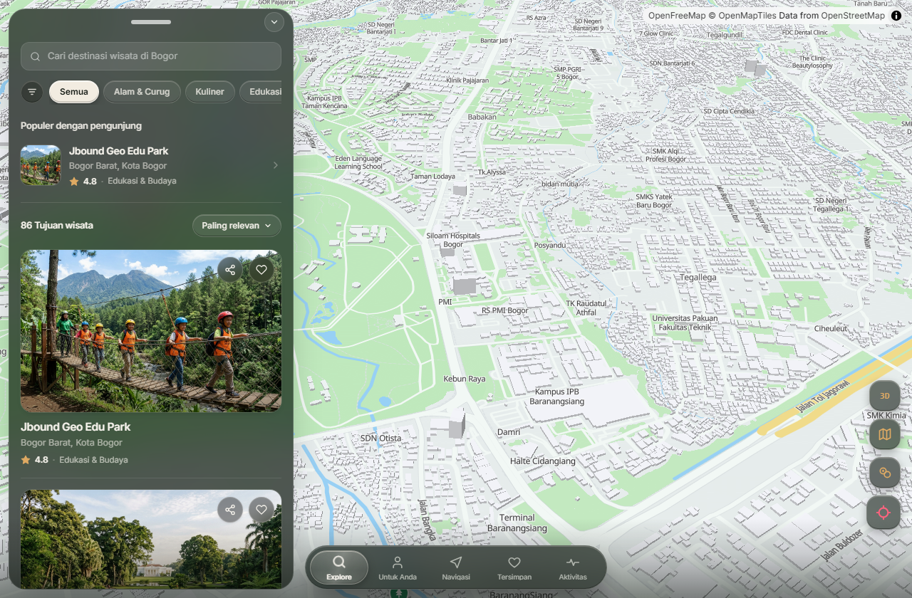

- **Waktu Tangkap**: `2026-11-22 11:37:09 WIB`
- **Endpoint API & HTTP Status**: `GET /api/tourists` (`200`, `55 ms`), `GET /api/boundary` (`200`, `314 ms`)
- **Status Console**: `0` Console Error, `0` Uncaught Exception *(tercatat warning geolocation expected sebelum izin GPS diberikan)*
- **Observasi Teknis & DOM**: Judul dokumen `"Sabah Bogor - Arahin Kamu ke Wisata Kota Bogor"`, `1` canvas peta vector 3D tampil penuh, `86` pin marker terpasang, heading sidebar `"86 Tujuan wisata"`, serta `aside[role="alert"]` tidak di-mount di DOM (`hiddenAlertMounted: false`, `errorTextInBody: false`).

---

### BB-02 — Audit Pemuatan Media Gambar & Fallback Istana Kepresidenan Bogor

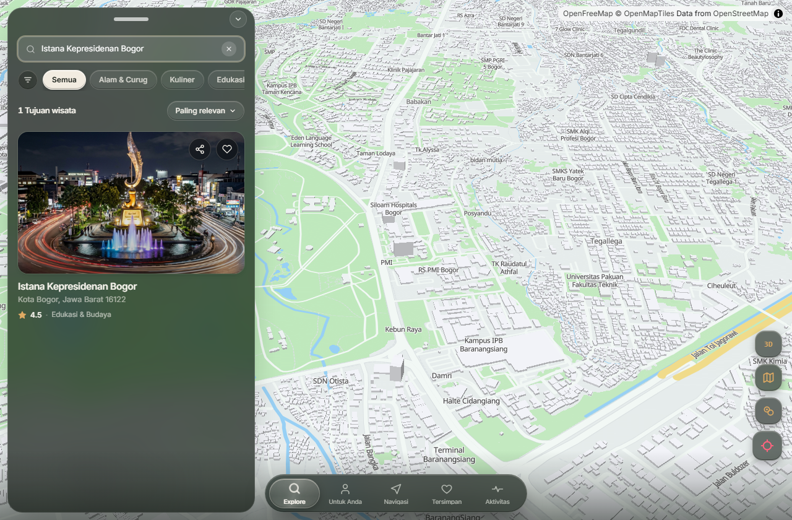

- **Waktu Tangkap**: `2026-11-22 11:37:11 WIB`
- **Endpoint API & HTTP Status**: Pencarian client-side terhadap dataset yang telah dimuat (asset gambar lokal HTTP `200`)
- **Status Console**: `0` Console Error, `0` Uncaught Exception
- **Observasi Teknis & DOM**: Total `87` elemen `` teraudit dengan hasil `broken: 0` dan `blobs: 0`. Kartu *Istana Kepresidenan Bogor* memuat gambar `http://127.0.0.1:8000/images/spots/tugu-kujang.jpg` (`complete: true`, `naturalWidth: 1024`).

---

### BB-03 — Filter Kategori, Filter Lanjutan (Rating 4.5+), Reset, & Kontrol Peta

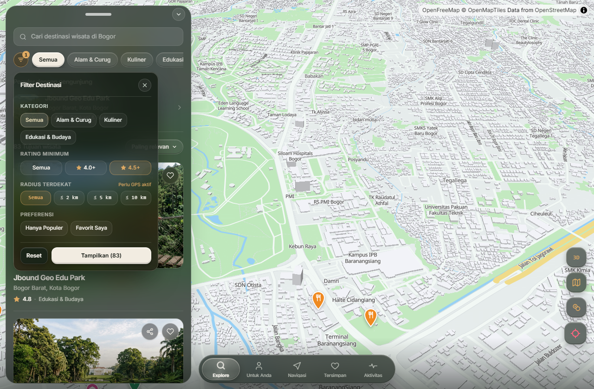

- **Waktu Tangkap**: `2026-11-22 11:37:14 WIB`
- **Endpoint API & HTTP Status**: Tidak ada panggilan API tambahan (filter client-side)
- **Status Console**: `0` Console Error, `0` Uncaught Exception
- **Observasi Teknis & DOM**: Pill kategori `Kuliner` memfilter ke `"14 Tujuan wisata"`; modal *Filter Destinasi* dengan rating minimum `4.5+` menampilkan tombol `"Tampilkan (83)"`; fungsi `Reset` mengembalikan jumlah ke `86`; serta kontrol peta `3D`, `Boundary`, dan `Cluster` merespons normal.

---

### BB-04 — Pencarian Keyword Valid, Empty State, & Keamanan Payload XSS

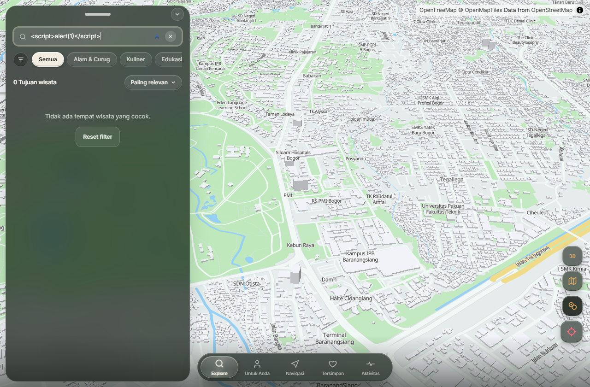

- **Waktu Tangkap**: `2026-11-22 11:37:15 WIB`
- **Endpoint API & HTTP Status**: Tidak ada panggilan API tambahan (pencarian client-side)
- **Status Console**: `0` Console Error, `0` Uncaught Exception
- **Observasi Teknis & DOM**: Pencarian `"Kebun Raya"` menghasilkan `"5 Tujuan wisata"`; input payload `` tidak mengeksekusi script maupun membuka dialog alert browser (`xssDialogs: 0`), menampilkan `"0 Tujuan wisata"`, teks `"Tidak ada tempat wisata yang cocok."`, dan tombol `"Reset filter"`.

---

### BB-05 — Penanganan Filter Radius & Tombol Lokasi Saya Saat Izin GPS Ditolak

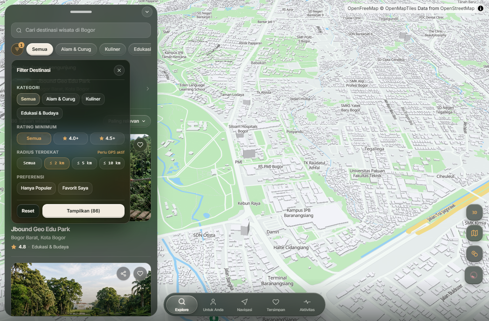

- **Waktu Tangkap**: `2026-11-22 11:37:17 WIB`
- **Endpoint API & HTTP Status**: Tidak ada panggilan API tambahan
- **Status Console**: `0` Console Error, `0` Uncaught Exception *(geolocation denied warning expected)*
- **Observasi Teknis & DOM**: Saat izin GPS ditolak, bagian *RADIUS TERDEKAT* menampilkan label peringatan kuning `"Perlu GPS aktif"` (`hasGpsNote: true`) dan pilihan `<= 2 km` tetap menjaga hasil stabil di `"Tampilkan (86)"`.

---

### BB-06 — Validasi Registrasi dengan Seluruh Input Kosong

- **Waktu Tangkap**: `2026-11-22 11:37:19 WIB`
- **Endpoint API & HTTP Status**: Tidak ada panggilan API (diblokir validasi client-side)
- **Status Console**: `0` Console Error, `0` Uncaught Exception
- **Observasi Teknis & DOM**: Modal *Buat akun baru* menahan pengiriman form dan menampilkan alert inline `"Nama lengkap minimal 2 karakter."`.

---

### BB-07 — Validasi Registrasi dengan Format Email Tidak Valid

- **Waktu Tangkap**: `2026-11-22 11:37:20 WIB`
- **Endpoint API & HTTP Status**: Tidak ada panggilan API (diblokir validasi client-side)
- **Status Console**: `0` Console Error, `0` Uncaught Exception
- **Observasi Teknis & DOM**: Input email `"bukan-email-valid"` ditolak sebelum menyentuh backend dengan pesan error `"Masukkan alamat email yang valid."`.

---

### BB-08 — Validasi Registrasi Kata Sandi Kurang dari 6 Karakter

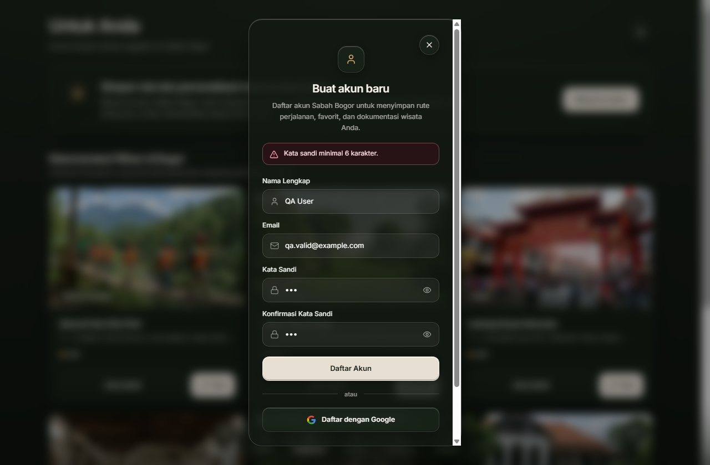

- **Waktu Tangkap**: `2026-11-22 11:37:20 WIB`
- **Endpoint API & HTTP Status**: Tidak ada panggilan API (diblokir validasi client-side)
- **Status Console**: `0` Console Error, `0` Uncaught Exception
- **Observasi Teknis & DOM**: Kata sandi 3 karakter menampilkan pesan validasi `"Kata sandi minimal 6 karakter."`.

---

### BB-09 — Validasi Registrasi Konfirmasi Kata Sandi Tidak Cocok

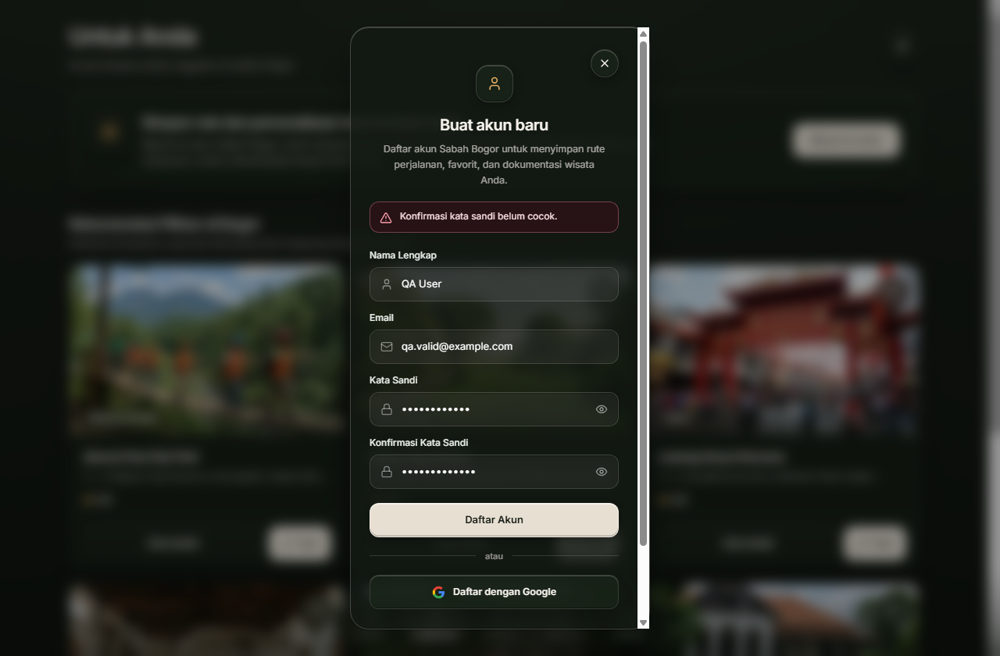

- **Waktu Tangkap**: `2026-11-22 11:37:21 WIB`
- **Endpoint API & HTTP Status**: Tidak ada panggilan API (diblokir validasi client-side)
- **Status Console**: `0` Console Error, `0` Uncaught Exception
- **Observasi Teknis & DOM**: Ketika kata sandi dan konfirmasi berbeda, form menahan submit dan menampilkan alert `"Konfirmasi kata sandi belum cocok."`.

---

### BB-10 — Registrasi Sukses, Toggle Password Eye, & Proteksi Double-Click Submit

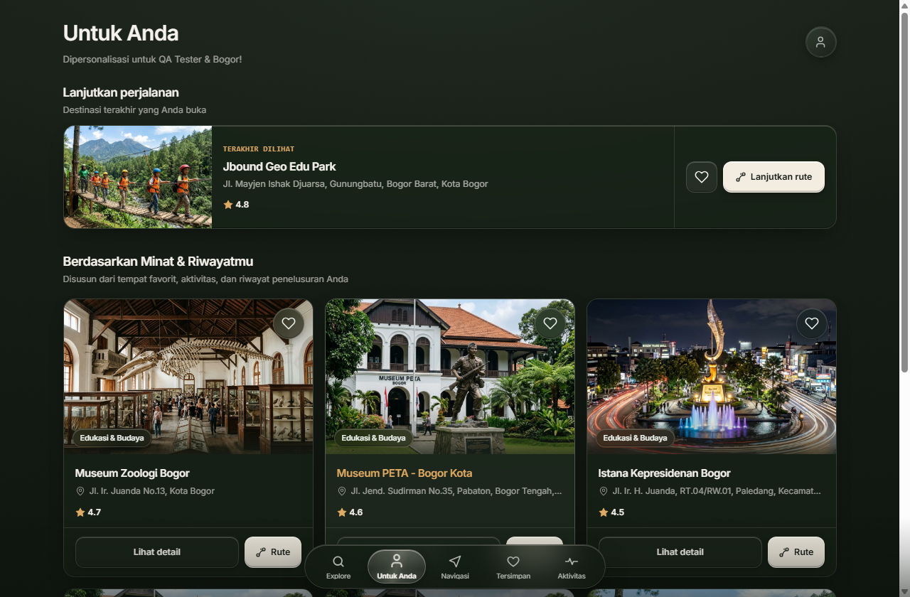

- **Waktu Tangkap**: `2026-11-22 11:37:23 WIB`
- **Endpoint API & HTTP Status**: `POST /api/auth/register` (`201`, `306 ms`), `GET /api/for-you?favorites=&recent=` (`200`, `16 ms` & `26 ms`)
- **Status Console**: `0` Console Error, `0` Uncaught Exception
- **Observasi Teknis & DOM**: Tombol eye toggle mengubah tipe input `password` menjadi `text`; klik ganda cepat pada `Daftar Akun` hanya mengirim `1` request `POST /api/auth/register` (`201`); modal tertutup otomatis (`dialogOpen: false`); dan halaman *Untuk Anda* menampilkan header personalisasi `"Dipersonalisi untuk QA Tester & Bogor!"`.

---

### BB-11 — Persistensi Sesi Autentikasi Setelah Reload Halaman Penuh (F5)

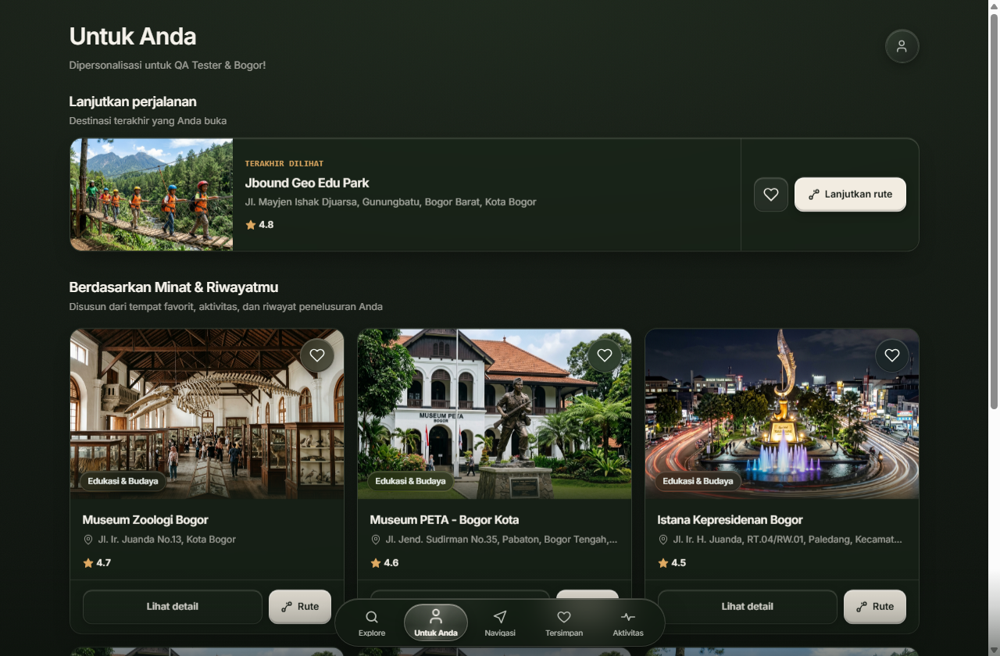

- **Waktu Tangkap**: `2026-11-22 11:37:25 WIB`
- **Endpoint API & HTTP Status**: `GET /api/auth/current-user` (`200`, `150 ms`), `GET /api/tourists` (`200`, `150 ms`), `GET /api/boundary` (`200`, `288 ms`), `GET /api/for-you?favorites=&recent=` (`200`, `12 ms`)
- **Status Console**: `0` Console Error, `0` Uncaught Exception
- **Observasi Teknis & DOM**: Setelah full reload halaman, token sesi tetap aktif (`hasLoginGate: false`, `personalized: true`) dan rekomendasi destinasi pada *Untuk Anda* langsung tampil.

---

### BB-12 — Penolakan Registrasi dengan Email yang Sudah Terdaftar

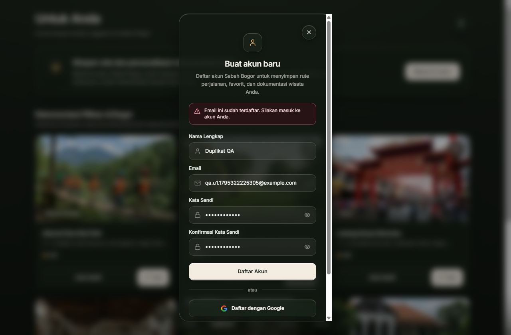

- **Waktu Tangkap**: `2026-11-22 11:37:32 WIB`
- **Endpoint API & HTTP Status**: `POST /api/auth/register` (`422`, `46 ms`)
- **Status Console**: `0` Console Error, `0` Uncaught Exception
- **Observasi Teknis & DOM**: Pendaftaran ulang memakai email aktif `qa.u1.1795322225305@example.com` ditolak server (`422`) dan menampilkan pesan `"Email ini sudah terdaftar. Silakan masuk ke akun Anda."`.

---

### BB-13 — Logout Akun & Kembali ke Tampilan Tamu (Guest Gate)

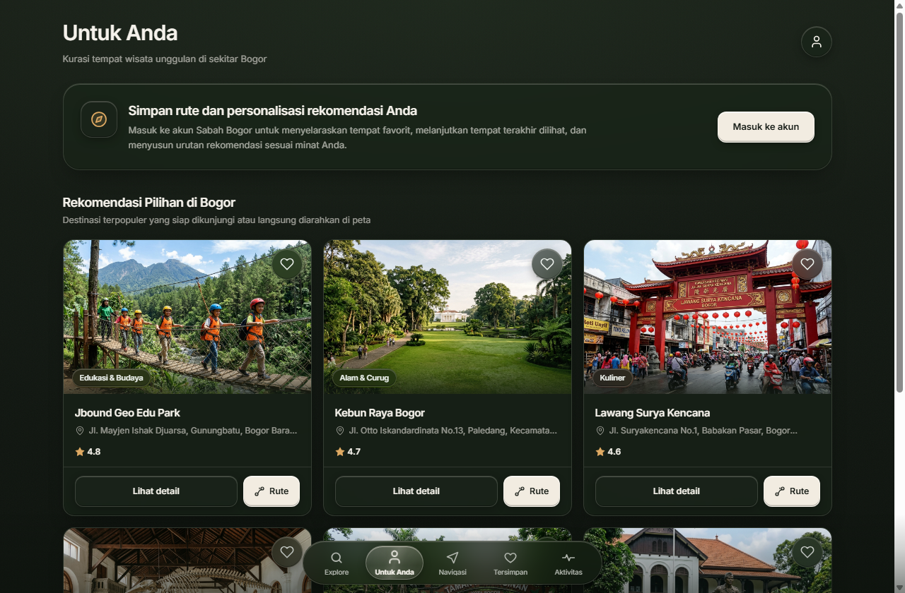

- **Waktu Tangkap**: `2026-11-22 11:37:29 WIB`
- **Endpoint API & HTTP Status**: `GET /api/users/qa-tester-bogor-5` (`200`, `13 ms`), `GET /api/saved-activities` (`200`, `30 ms`), `POST /api/auth/logout` (`200`, `93 ms`), `GET /api/boundary` (`200`, `40 ms`)
- **Status Console**: `0` Console Error, `0` Uncaught Exception
- **Observasi Teknis & DOM**: Halaman *Profil Saya* memverifikasi nama/email tampil (`true`); setelah menekan `Keluar dari Akun`, tab *Untuk Anda* kembali menampilkan banner `"Simpan rute dan personalisasi rekomendasi Anda"` beserta tombol `"Masuk ke akun"` (`guestGateVisible: true`).

---

### BB-14 — Validasi Login dengan Input Kosong

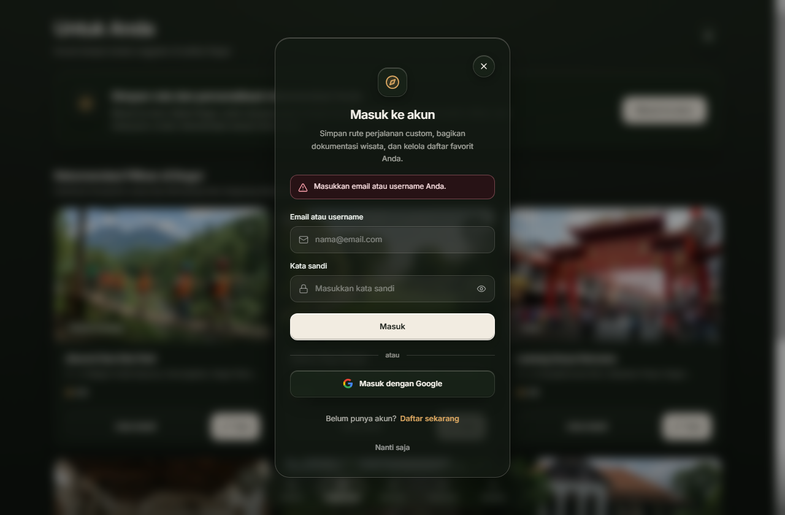

- **Waktu Tangkap**: `2026-11-22 11:37:32 WIB`
- **Endpoint API & HTTP Status**: Tidak ada panggilan API (diblokir validasi client-side)
- **Status Console**: `0` Console Error, `0` Uncaught Exception
- **Observasi Teknis & DOM**: Modal *Masuk ke akun* menahan proses login saat semua kolom kosong dan menampilkan `"Masukkan email atau username Anda."`.

---

### BB-15 — Validasi Login dengan Kata Sandi Kosong

- **Waktu Tangkap**: `2026-11-22 11:37:33 WIB`
- **Endpoint API & HTTP Status**: Tidak ada panggilan API (diblokir validasi client-side)
- **Status Console**: `0` Console Error, `0` Uncaught Exception
- **Observasi Teknis & DOM**: Saat email terisi namun kata sandi kosong, tampil pesan validasi `"Masukkan kata sandi Anda."`.

---

### BB-16 — Penolakan Login dengan Kata Sandi Salah

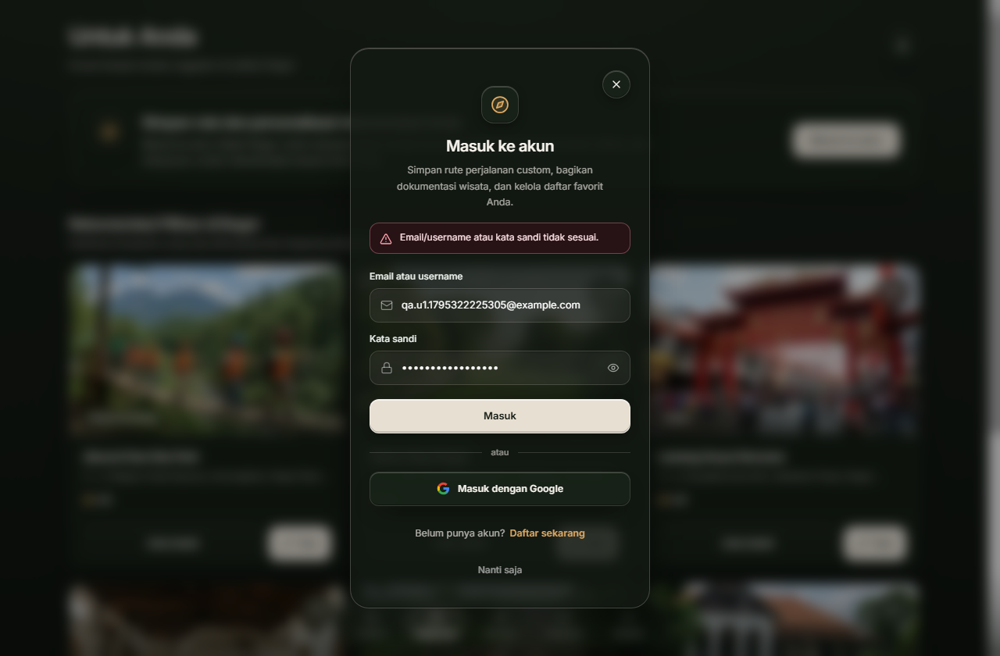

- **Waktu Tangkap**: `2026-11-22 11:37:34 WIB`
- **Endpoint API & HTTP Status**: `POST /api/auth/login` (`401`, `286 ms`)
- **Status Console**: `0` Console Error, `0` Uncaught Exception
- **Observasi Teknis & DOM**: Percobaan login menggunakan `"SalahPassword999!"` ditolak server (`401`) dengan alert `"Email/username atau kata sandi tidak sesuai."`.

---

### BB-17 — Penolakan Payload SQL Injection pada Form Login

- **Waktu Tangkap**: `2026-11-22 11:37:35 WIB`
- **Endpoint API & HTTP Status**: `POST /api/auth/login` (`401`, `53 ms`)
- **Status Console**: `0` Console Error, `0` Uncaught Exception
- **Observasi Teknis & DOM**: Input email `' OR '1'='1` dengan kata sandi `"password123"` ditolak (`401`), modal tetap terbuka (`stillOpen: true`), dan pesan error kredensial ditampilkan aman.

---

### BB-18 — Login Sukses & Pemuatan Foto Kartu Rekomendasi "Untuk Anda"

- **Waktu Tangkap**: `2026-11-22 11:37:37 WIB`
- **Endpoint API & HTTP Status**: `POST /api/auth/login` (`200`, `255 ms`), `GET /api/for-you?favorites=&recent=` (`200`, `21 ms` & `28 ms`)
- **Status Console**: `0` Console Error, `0` Uncaught Exception
- **Observasi Teknis & DOM**: Modal tertutup (`dialogOpen: false`), personalisasi aktif (`hasGreeting: true`), dan `7` foto pada halaman *Untuk Anda* ter-render sempurna (`brokenImgs: 0`).

---

### BB-19a — Verifikasi Klik Pertama Kartu Sidebar Langsung Membuka Popup

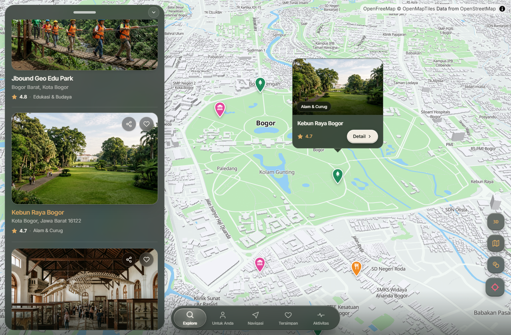

- **Waktu Tangkap**: `2026-11-22 11:37:42 WIB` *(fase 1 skenario `BB-19`, tepat sebelum klik marker peta)*
- **Endpoint API & HTTP Status**: Interaksi DOM / peta lokal
- **Status Console**: `0` Console Error, `0` Uncaught Exception
- **Observasi Teknis & DOM**: Klik pertama kali pada kartu sidebar `"Kebun Raya Bogor"` langsung memusatkan peta dan membuka popup destinasi (`"Alam & Curug / Kebun Raya Bogor / 4.7 / Detail >"`).

---

### BB-19 — Verifikasi Klik Pertama Pin Marker Peta & Navigasi ke Detail Wisata

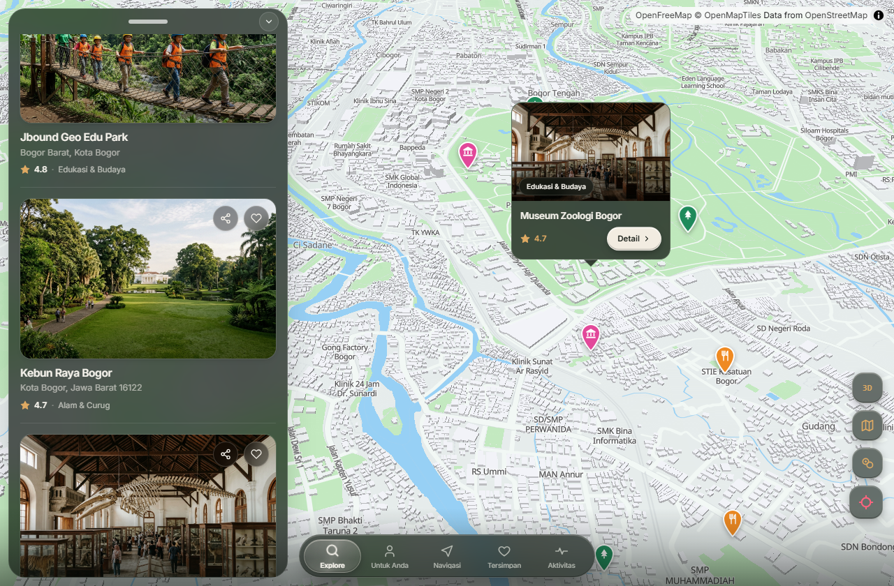

- **Waktu Tangkap**: `2026-11-22 11:37:42 WIB`
- **Endpoint API & HTTP Status**: Interaksi marker peta & transisi rute SPA menuju `/place/museum-zoologi-bogor`
- **Status Console**: `0` Console Error, `0` Uncaught Exception
- **Observasi Teknis & DOM**: Klik pertama kali pada marker `"Museum Zoologi Bogor"` langsung membuka popup `"Edukasi & Budaya / Museum Zoologi Bogor / 4.7 / Detail >"` (`markerPopupMatches: true`), dan klik `Detail >` menavigasikan ke `http://127.0.0.1:8000/place/museum-zoologi-bogor`.

---

### BB-20 — Halaman Detail Wisata: Info Lengkap, Galeri Foto, Favorit, & Bagikan

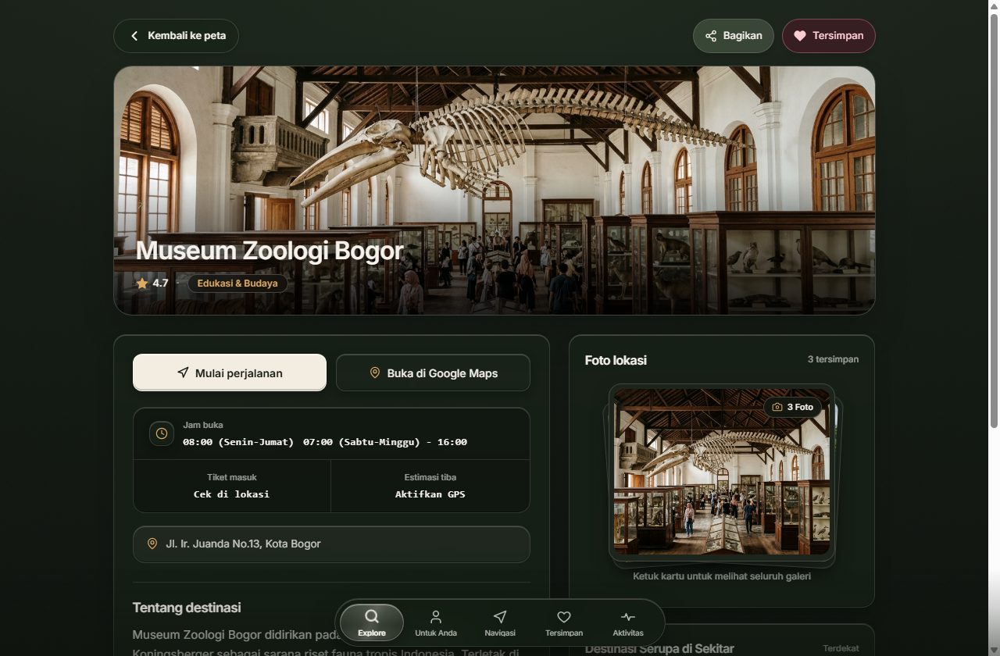

- **Waktu Tangkap**: `2026-11-22 11:37:43 WIB`
- **Endpoint API & HTTP Status**: Data detail destinasi dimuat dari state / aset lokal (`200`)
- **Status Console**: `0` Console Error, `0` Uncaught Exception
- **Observasi Teknis & DOM**: Halaman detail `Museum Zoologi Bogor` menampilkan jam buka (`hasHours: true`), bagian *Tentang destinasi* (`hasAbout: true`), galeri foto `3 Foto` (`brokenImgs: 0`), dan tombol favorit berubah menjadi `"Tersimpan"`.

---

### BB-21 — State 404 Halaman Detail Wisata untuk Slug Tidak Terdaftar

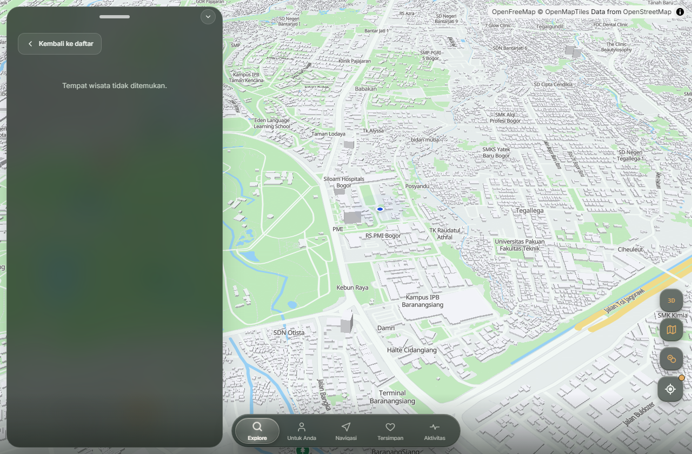

- **Waktu Tangkap**: `2026-11-22 11:37:54 WIB`
- **Endpoint API & HTTP Status**: `GET /api/tourists` (`200`, `19 ms`), `GET /api/auth/current-user` (`200`, `39 ms`), `GET /api/boundary` (`200`, `48 ms`)
- **Status Console**: `0` Console Error, `0` Uncaught Exception
- **Observasi Teknis & DOM**: Akses URL `/place/destinasi-palsu-qa-404` menampilkan panel kosong yang aman dengan teks `"Tempat wisata tidak ditemukan."` (`hasNotFoundMsg: true`) dan tombol `"< Kembali ke daftar"` (`hasBackBtn: true`).

---

### BB-22a — Navigasi Rute Saat GPS Ditolak (Fallback Pusat Kota Bogor)

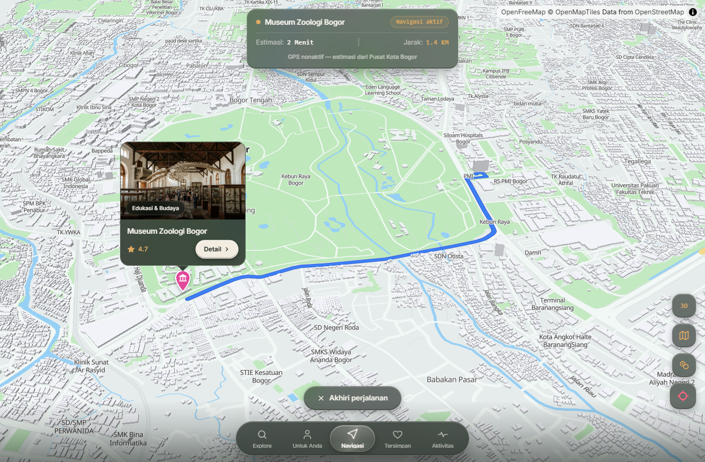

- **Waktu Tangkap**: `2026-11-22 11:37:53 WIB` *(fase GPS ditolak dari skenario `BB-22`)*
- **Endpoint API & HTTP Status**: `GET /api/boundary` (`200`) & kalkulasi rute polyline
- **Status Console**: `0` Console Error, `0` Uncaught Exception *(geolocation denied warning expected)*
- **Observasi Teknis & DOM**: Saat GPS ditolak, panel HUD navigasi untuk `Museum Zoologi Bogor` tidak stuck pada `"Menghitung..."` (`stuck: false`), langsung menampilkan `"Estimasi: 2 Menit"`, `"Jarak: 1.4 KM"`, serta keterangan fallback `"GPS nonaktif — estimasi dari Pusat Kota Bogor"`.

---

### BB-22 — Navigasi Rute Saat GPS Aktif & Rute Polyline Terkalkulasi

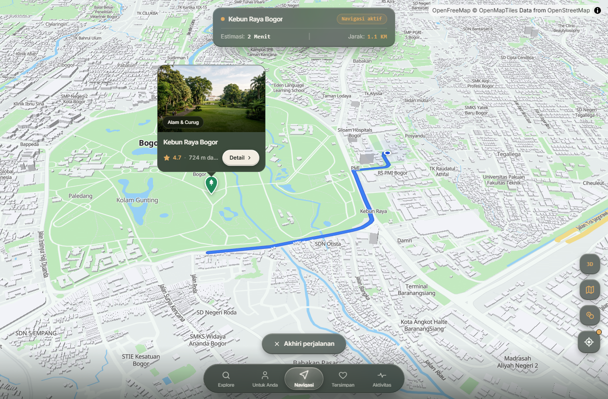

- **Waktu Tangkap**: `2026-11-22 11:37:53 WIB`
- **Endpoint API & HTTP Status**: `GET /api/boundary` (`200`, `31–54 ms`) & kalkulasi routing
- **Status Console**: `0` Console Error, `0` Uncaught Exception
- **Observasi Teknis & DOM**: Setelah izin GPS diaktifkan pada koordinat `-6.5971, 106.8060`, navigasi menuju `Kebun Raya Bogor` menampilkan jalur biru, titik GPS pengguna, dan metrik HUD `"Estimasi: 2 Menit"`, `"Jarak: 1.1 KM"` (`stuck: false`).

---

### BB-23 — Aktivitas Tersimpan: Validasi Modal Kosong, Tambah, & Hapus Catatan

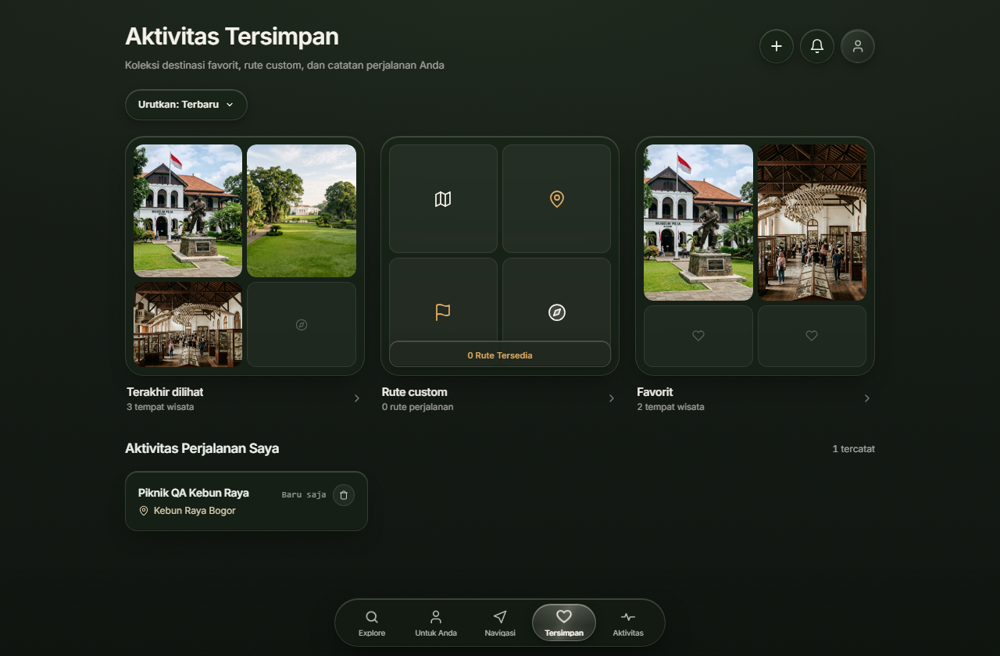

- **Waktu Tangkap**: `2026-11-22 11:38:00 WIB`
- **Endpoint API & HTTP Status**: `POST /api/saved-activities` (`201`, `18 ms`), `DELETE /api/saved-activities/8` (`200`, `18 ms`)
- **Status Console**: `0` Console Error, `0` Uncaught Exception
- **Observasi Teknis & DOM**: Submit form kosong menahan modal terbuka (`actStaysOpenEmpty: true`); penyimpanan catatan `"Piknik QA Kebun Raya"` di `"Kebun Raya Bogor"` tampil pada bagian *Aktivitas Perjalanan Saya* (`actCreated: true`) bersama kartu koleksi *Terakhir dilihat* dan *Favorit* (`2 tempat wisata`), lalu terhapus bersih via API (`actDeleted: true`).

---

### BB-24 — Rute Custom: Validasi Kosong, Kalkulasi Jarak, & Persistensi Reload (F5)

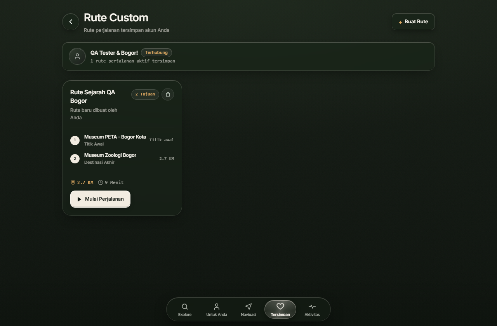

- **Waktu Tangkap**: `2026-11-22 11:38:06 WIB`
- **Endpoint API & HTTP Status**: `GET /api/saved-activities` (`200`, `11–20 ms`), `POST /api/custom-routes` (`201`, `18 ms`), reload `GET /api/tourists` (`200`, `41 ms`), `GET /api/auth/current-user` (`200`, `125 ms`), `GET /api/boundary` (`200`, `146 ms`)
- **Status Console**: `0` Console Error, `0` Uncaught Exception
- **Observasi Teknis & DOM**: Modal kosong tertahan (`routeEmptyHeld: true`); rute `"Rute Sejarah QA Bogor"` (`2 Tujuan`: `Museum PETA - Bogor Kota` `Titik awal` -> `Museum Zoologi Bogor` `2.7 KM`, total `2.7 KM` / `9 Menit`) tersimpan dan tetap ada setelah `F5` (`routePersists: true`).

---

### BB-25 — Navigasi Rute Custom & Rating Popup "Lokasi transit"

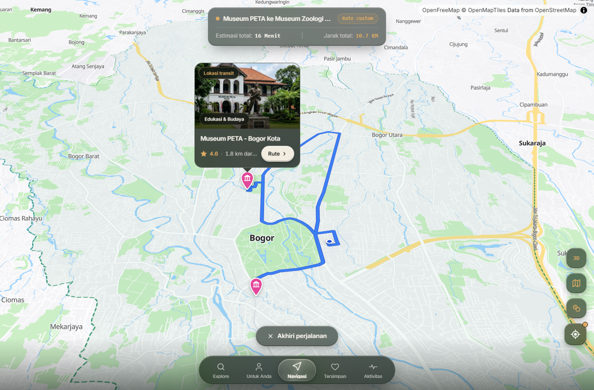

- **Waktu Tangkap**: `2026-11-22 11:38:13 WIB`
- **Endpoint API & HTTP Status**: `GET /api/boundary` (`200`, `28–50 ms`), `GET /api/saved-activities` (`200`, `16–22 ms`), `DELETE /api/custom-routes/cr-1795322282-jywg` (`200`, `17 ms`)
- **Status Console**: `0` Console Error, `0` Uncaught Exception
- **Observasi Teknis & DOM**: HUD navigasi menampilkan `"Museum PETA ke Museum Zoologi Bogor"`, badge `"Rute custom"`, `"Estimasi total: 16 Menit"`, dan `"Jarak total: 10.7 KM"`. Popup `"Lokasi transit"` pada `Museum PETA - Bogor Kota` menampilkan angka rating valid `4.6` (`hasTransitRating: true`), dan rute custom berhasil dihapus kembali setelah uji (`routeDeleted: true`).

---

### BB-26 — Halaman Profil Saya & Identitas Akun Pribadi

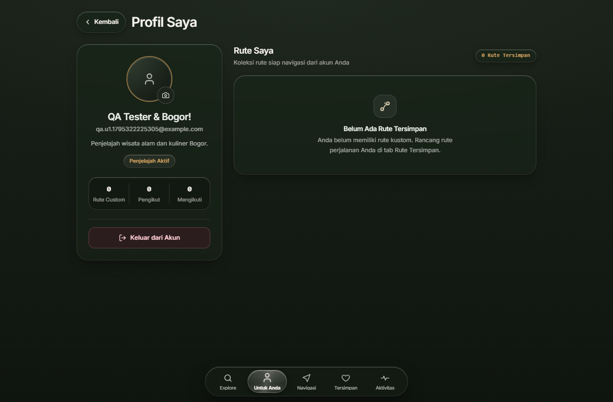

- **Waktu Tangkap**: `2026-11-22 11:38:15 WIB`
- **Endpoint API & HTTP Status**: `GET /api/for-you?favorites=museum-zoologi-bogor%2Cmuseum-peta&recent=museum-peta%2Ckebun-raya-bogor%2Cmuseum-zoologi-bogor` (`200`, `12 ms`), `GET /api/users/qa-tester-bogor-5` (`200`, `19 ms`), `GET /api/saved-activities` (`200`, `31 ms`)
- **Status Console**: `0` Console Error, `0` Uncaught Exception
- **Observasi Teknis & DOM**: Menampilkan judul `"Profil Saya"`, nama lengkap `"QA Tester & Bogor!"`, email pribadi `qa.u1.1795322225305@example.com`, badge `Penjelajah Aktif`, statistik (`0 Rute Custom`, `0 Pengikut`, `0 Mengikuti`), tombol `Keluar dari Akun`, dan panel `Rute Saya`.

---

### BB-27 — Feed Komunitas: Validasi Modal +Post & Publikasi ke Tab Kamu/Komunitas

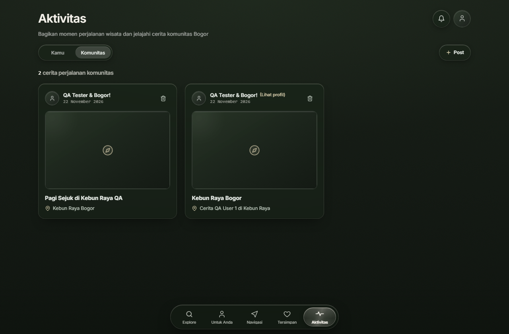

- **Waktu Tangkap**: `2026-11-22 11:38:19 WIB`
- **Endpoint API & HTTP Status**: `GET /api/activities` (`200`, `14 ms`), `POST /api/activities` (`201`, `24 ms`)
- **Status Console**: `0` Console Error, `0` Uncaught Exception
- **Observasi Teknis & DOM**: Submit modal `+ Post` dalam keadaan kosong tertahan (`postEmptyHeld: true`); setelah diisi lokasi `"Kebun Raya Bogor"` dan cerita `"Pagi Sejuk di Kebun Raya QA"`, postingan muncul baik di tab `Kamu` (`visibleInKamu: true`) maupun tab `Komunitas` (`visibleInKomunitas: true`).

---

### BB-28 — Profil Penjelajah Lintas-Akun: Privasi Email, Otorisasi, & Follow Persisten

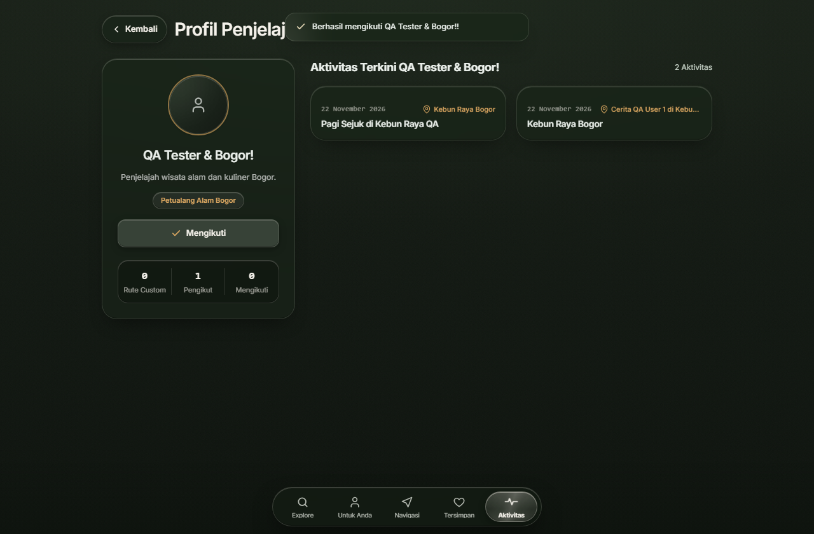

- **Waktu Tangkap**: `2026-11-22 11:38:31 WIB`
- **Endpoint API & HTTP Status**: `GET /api/activities` (`200`, `13–16 ms`), `GET /api/users/15` (`200`, `15–17 ms`), `POST /api/users/15/follow` (`200`, `22–23 ms`), reload (`GET /api/tourists`, `GET /api/auth/current-user`, `GET /api/boundary` semua `200`)
- **Status Console**: `0` Console Error, `0` Uncaught Exception
- **Observasi Teknis & DOM**: Saat masuk sebagai User 2 (`QA Penjelajah Dua`), kartu postingan User 1 di *Komunitas* tidak memiliki tombol hapus (`hasDeleteBtnOnOtherPost: false`); membuka *Profil Penjelajah* User 1 tidak memaparkan email pribadi apapun (`exposesUser1Email: false`, `exposesAnyEmail: false`); tombol `"Ikuti Perjalanan"` berubah menjadi `"Mengikuti"` dengan jumlah `1 Pengikut` dan toast `"Berhasil mengikuti QA Tester & Bogor!!"`, tetap persisten pasca reload `F5` (`followAfterReload: "Mengikuti"`), serta berhasil dibatalkan kembali ke `"Ikuti Perjalanan"`.

---

### BB-29 — Penghapusan Postingan Milik Sendiri via Modal Konfirmasi

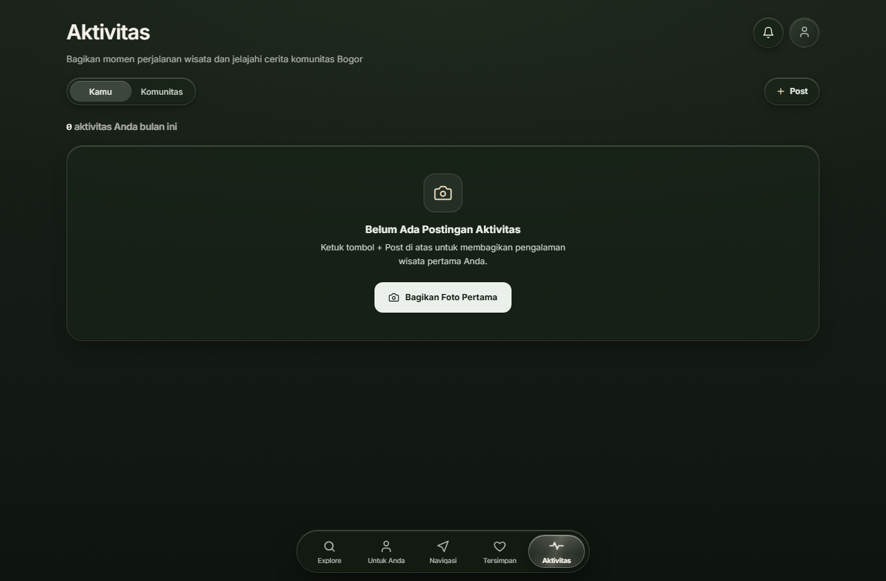

- **Waktu Tangkap**: `2026-11-22 11:38:37 WIB`
- **Endpoint API & HTTP Status**: `DELETE /api/activities/5` (`200`, `18 ms`)
- **Status Console**: `0` Console Error, `0` Uncaught Exception
- **Observasi Teknis & DOM**: Kembali masuk sebagai User 1 pada tab `Aktivitas -> Kamu`, menekan tombol hapus memunculkan dialog konfirmasi (`deleteDialogOpen: true`), dan menekan `"Ya, Hapus"` menghapus postingan `"Pagi Sejuk di Kebun Raya QA"` secara permanen (`cleanupDeletedPost: true`, menampilkan `"0 aktivitas Anda bulan ini"` dan `"Belum Ada Postingan Aktivitas"`).
